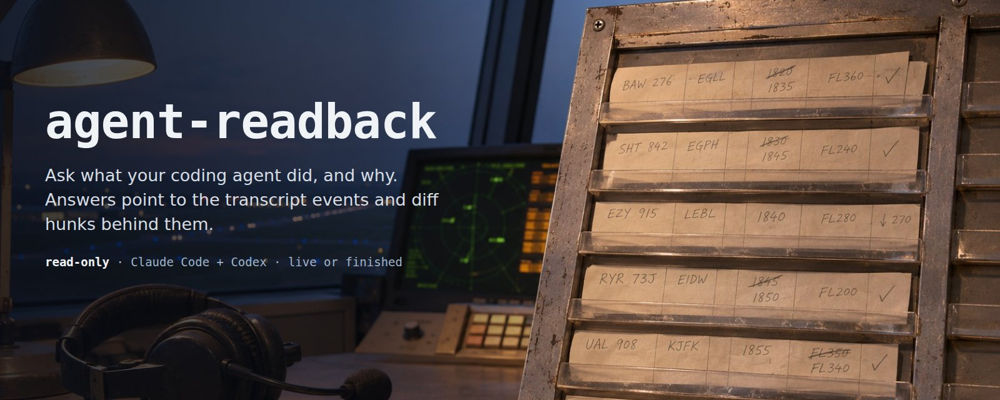
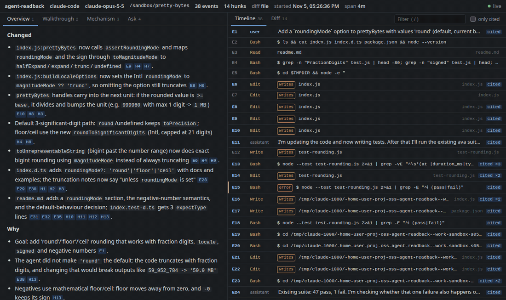
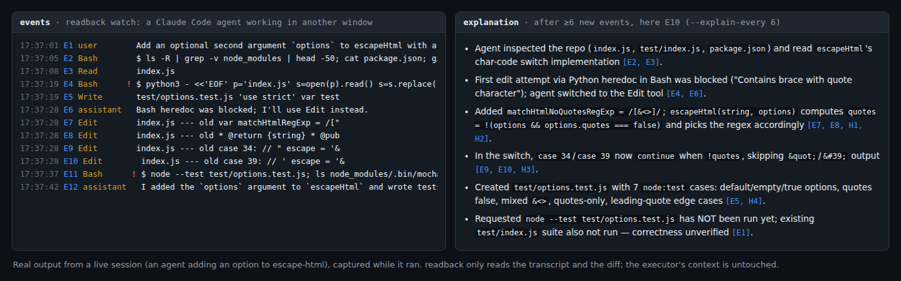
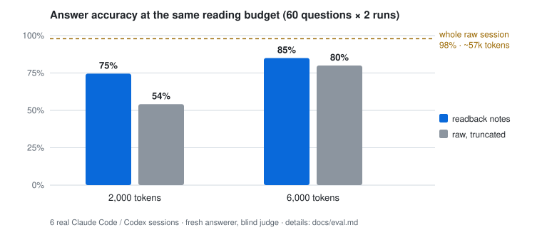
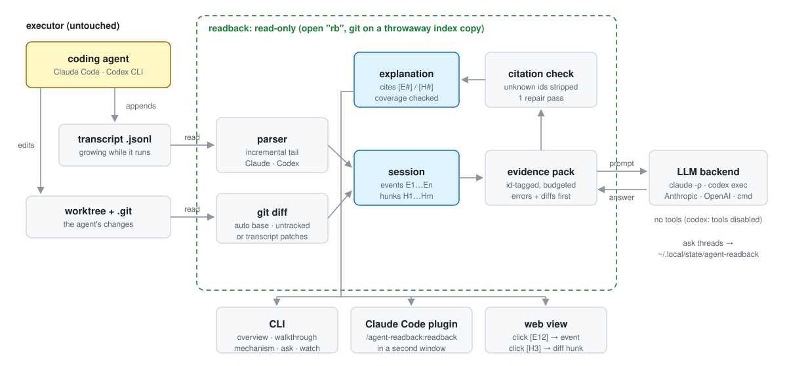

<p align="center"></p>

# agent-readback

A read-only explainer for coding-agent sessions. Point it at a running or finished **Claude Code** or **Codex CLI** session, and it explains what the agent did and why, mechanistically, over as many follow-up questions as you like. Claims cite the transcript event (`[E12]`) and the diff hunk (`[H3]`) they come from. Every answer from the explain modes is checked for missing or invalid citations and, if coverage is under 90% or an id is unknown, repaired once (`watch` delta notes are only stripped of unknown ids); in the eval, 97.1% of factual lines (330 of 340) carried a valid citation.

The executor agent's repo is never written, with two narrow, disclosed exceptions (git's split index refreshes an mtime; a repo's own custom clean filter runs as git configures it; see [SECURITY.md](SECURITY.md)), and neither is its context when the plugin is loaded only in the explainer window: readback only reads the transcript file and the git diff, and asks a separate model that cannot write anything (unless you plug in your own `READBACK_CMD`, which runs as you). The default `claude` backend and the API backends give the model no tools at all; the `codex` backend disables web search and every tool-providing Codex feature, and a probe found no working tool, but that rests on Codex's feature flags (see [SECURITY.md](SECURITY.md)).

<p align="center"></p>

## Install

```bash
uv tool install git+https://github.com/vulbsti/agent-readback   # or: pipx install git+https://github.com/vulbsti/agent-readback
```

It needs Python 3.10+ and has zero runtime dependencies. CI passed on Linux and macOS (GitHub Actions, Python 3.10 and 3.13) up to commit `a23145f`; later commits were tested on Linux only (see BLOCKED.md). Windows is untested.

You also need one model backend. readback auto-detects them in this order:
1. `READBACK_CMD`: any command that reads the prompt on stdin and prints the answer, e.g. `READBACK_CMD="llm -m my-model"`.
2. The `claude` CLI, then the `codex` CLI (already signed in).
3. `ANTHROPIC_API_KEY`, then `OPENAI_API_KEY` (any compatible endpoint via `OPENAI_BASE_URL`; set `READBACK_MODEL`). These two are tested against a local stub server, not yet against the live APIs.

Force one with `--backend` or `READBACK_BACKEND`. Details: [docs/backends.md](docs/backends.md).

**Claude Code plugin:** load it in the explainer window only, so the executor's context stays untouched:

```bash
git clone https://github.com/vulbsti/agent-readback ~/agent-readback
claude --plugin-dir ~/agent-readback
```

You can also install it from the marketplace (`claude plugin marketplace add vulbsti/agent-readback`, then `claude plugin install agent-readback@agent-readback`). That install loads into every session, including the executor's, where it adds about 180 tokens of command and skill descriptions (Claude Code's own estimate). Details: [docs/plugin.md](docs/plugin.md).

## Quickstart

Try it first on one of the recorded eval sessions (no agent session of your own needed):

```bash
git clone https://github.com/vulbsti/agent-readback && cd agent-readback
rb() { readback "$@" -s eval/sessions/s06/transcript.jsonl --diff-file eval/sessions/s06/diff.patch; }
rb events      # the ids behind the citations (no model call)
rb overview    # what changed, why, tests, risks
rb ask "why does a single-part input skip the compound branch?"
```

Then use it on your own agent. Run these in the repo where the agent is working, from a second terminal or a second Claude Code window:

```bash
readback sessions                 # recent Claude Code / Codex sessions in this directory
readback overview                 # latest session here (else the newest anywhere)
readback walkthrough              # the agent's steps in order
readback mechanism                # data/control flow of the change: Mermaid diagram + bullets
readback ask "why TypeError and not ValueError?"   # multi-turn; `readback ask` alone prints the thread
readback watch --explain-every 10 # follow a running agent live
readback web                      # local web view (--port 8765, --no-open): click [E12] / [H3] to jump to the evidence
```

- **Choosing a session:** pick one with `-s <id-prefix | path>` and the agent's worktree with `--repo DIR`. `--base auto` (the default) diffs against the parent of the first commit (by committer date) made between the session's start and 10 minutes after its last record, else `HEAD`. Any commit in that window counts, whoever made it, and the diff is taken against the worktree as it is now, so for an old session whose repo has moved on, pass `--base <ref>` or `--diff-file`.
- **Speed and data:** each answer takes about 10–60 s with a CLI backend. Up to `--budget` tokens of evidence (default 40,000) are sent to the backend per model call. One answer can take up to three calls: the answer, a citation repair (which resends the pack) and a fit-to-screen shortening (which sends only the answer).

Full reference: [docs/usage.md](docs/usage.md). Plugin workflow: [docs/plugin.md](docs/plugin.md).

<p align="center"></p>

## Does it help? (measured)

Six real agent sessions (three `claude -p`, three `codex exec`) were recorded on small MIT-licensed repos, with 10 factual questions each. A fresh model answered the questions from either readback's notes or the raw transcript and diff, cut to the **same token budget**, and a blind judge graded the answers.

<picture>
  <source media="(prefers-color-scheme: dark)" srcset="docs/img/eval-dark.svg">
  
</picture>

| budget | readback | raw transcript + diff |
|---|---|---|
| 2,000 tokens | **74.6%** | 54.2% |
| 6,000 tokens | **85.0%** | 80.0% |
| no limit (~57k tokens) | — | 97.9% |

Reading the whole raw session is still the most accurate option. readback wins when reading time or context is limited. The method, per-session numbers, iteration history (including a parser bug the eval found) and threats to validity are in [docs/eval.md](docs/eval.md).

## How it works

<picture>
  <source media="(prefers-color-scheme: dark)" srcset="docs/img/architecture-dark.svg">
  
</picture>

1. **Parse.** The parser is incremental, so it handles live transcripts. A tool call and its result become one event (`E7`: "ran pytest, failed with X").
2. **Diff.** `git diff` runs with `--no-optional-locks` against a throwaway copy of the index, because a plain `git diff` rewrites `.git/index` when files are stat-dirty. Untracked files are read directly, never staged. Without a repo, readback falls back to the edits recorded in the transcript.
3. **Pack.** An id-tagged evidence pack is cut to a token budget. The user's prompts, the agent's own words, failures and diff hunks get the most room.
4. **Explain.** A separate model, running in a temp dir with no tools (for `codex`: tool features disabled), writes a terse answer. Answers longer than one screen (48 rows × 120 columns) get one shortening pass, and the style rules live in [`prompts.py`](src/agent_readback/prompts.py).
5. **Check.** Unknown ids are stripped. If coverage is under 90%, one repair pass adds citations. Coverage is printed with every answer except `watch` delta notes, which are not repaired.

**Read-only guarantee.** [`tests/test_readonly.py`](tests/test_readonly.py) hashes every file in the transcript and the worktree (including `.git`), with mtimes, before and after a full session. That session covers every mode, a multi-turn ask, live watch, the web API, and a backend that deliberately tries to write to its cwd. The test then asserts that nothing changed. Details: [docs/architecture.md](docs/architecture.md), [SECURITY.md](SECURITY.md).

**What leaves your machine:**
- The evidence pack (transcript excerpts and diff) goes to the backend you choose.
- The web view loads Mermaid from cdn.jsdelivr.net, and only when it has a diagram to draw.

readback sends nothing else and has no telemetry.

## Alternatives

Claude Code's `/btw` answers one side question from the live context. Transcript viewers such as claude-code-log and claude-code-viewer render sessions but do not explain them. agentdiff maps hunks to transcript turns without an LLM. Entire, SpecStory and git-ai record or attribute agent work, and PR bots (PR-Agent, CodeRabbit) explain diffs but not sessions. readback is narrower than most of these: it supports two transcript formats, has no hosted UI and needs an LLM backend. The full, checked comparison is in [docs/alternatives.md](docs/alternatives.md).

## Project

[CONTRIBUTING.md](CONTRIBUTING.md) · [AGENTS.md](AGENTS.md) (for coding agents working on this repo) · [docs/ROADMAP.md](docs/ROADMAP.md) (good first issues) · [CHANGELOG.md](CHANGELOG.md) · [DECISIONS.md](DECISIONS.md) · Apache-2.0
