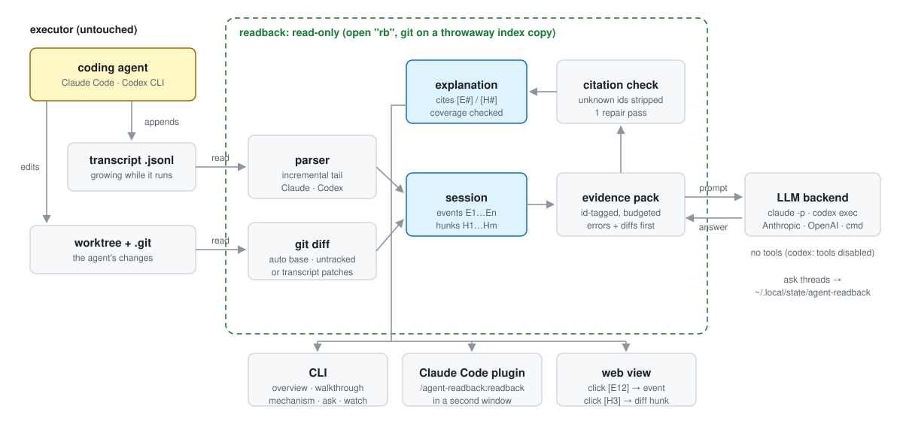

# Architecture

<picture>
  <source media="(prefers-color-scheme: dark)" srcset="img/architecture-dark.svg">
  
</picture>

readback turns a coding-agent transcript and the worktree it changed into a short explanation
whose claims cite transcript events (`[E#]`) and diff hunks (`[H#]`). Everything runs in one
process with the standard library; the only external calls are `git` (read-only) and the LLM
backend.

## Pipeline

```
transcript.jsonl ──> parser.feed() ──> Session(events)
                                          │
worktree / diff file ──> gitdiff.attach_diff() ──> Session(events, hunks)
                                          │
                                 evidence.render(budget)
                                          │
                         prompts.build(mode, pack, question, history)
                                          │
                               backend.complete(SYSTEM, prompt)
                                          │
                                 citations.check(text, ids)
                                          │  not ok (coverage < 90% or unknown ids)
                                 one repair pass (prompts.REPAIR)
                                          │
                       strip unknown ids ──> Explanation(text, cited, coverage, tokens)
```

### 1. Transcript to events (`transcripts/`)

- `resolve(spec)` maps `-s` (path, id or id prefix, `latest`) to a file. `latest` is the newest
  session whose cwd is `--repo` or the current directory, falling back to any directory. The
  caller's own Claude Code session (`CLAUDE_CODE_SESSION_ID`) is never picked.
- Roots: `READBACK_CLAUDE_DIR` (default `~/.claude/projects`, files `*/*.jsonl`) and
  `READBACK_CODEX_DIR` (default `~/.codex/sessions`, files `**/rollout-*.jsonl`).
- `_sniff()` reads the first 8 records to pick `ClaudeParser` or `CodexParser`.
- `Tail.poll()` reads only bytes appended since the last poll and only complete lines; a partial
  trailing line waits for the next poll. If the file shrinks, it restarts. `load()` is one poll
  plus the final unterminated line.
- Parsers are incremental: `feed(record, line)` per JSONL line. A tool call and its result become
  one `Event` (matched by `tool_use_id` / `call_id`). Codex code-mode `exec` calls fold the
  `item_completed` CommandExecution / FileChange records into the enclosing event. Injected
  context (system reminders, environment blocks, AGENTS.md text) is dropped.
- `Event` fields: `id`, `kind` (user | assistant | reasoning | tool), `text`, `tool`, `output`,
  `is_error`, `files`, `writes`, `patch`, `line`, `result_line`, `ts`.

### 2. Diff to hunks (`gitdiff.attach_diff`)

In order of preference:

1. `--diff-file PATH`: parse that unified diff (`diff_source=file`).
2. git worktree at `--repo` or the session's cwd: `git diff --find-renames <base>` plus untracked
   files rendered as new-file hunks (`diff_source=git:<base>`). `--base auto` (default) is the
   parent of the first commit (by committer date) made between the session's start and 10 minutes
   after its last record, or `HEAD` if none falls in that window; for a repo whose first commit was
   made during the session, the empty tree. The diff is against the current worktree, so for an old
   session whose repo has moved on, use `--base <ref>` or `--diff-file`.
3. Fallback when there is no repo or the diff is empty: the patches recorded in the transcript
   (Claude `structuredPatch` / Edit / Write, Codex `apply_patch` / FileChange),
   `diff_source=transcript`.

`parse_unified()` assigns `H1, H2, ...`. `_link_edits()` makes event paths repo-relative so events
and hunks name files the same way.

All git calls go through `_git()`: `git --no-optional-locks -C <repo>`, `GIT_OPTIONAL_LOCKS=0`,
stdin closed. `git diff` and `git ls-files` additionally run with `GIT_INDEX_FILE` pointing at a
throwaway copy of the index: `git diff <base>` refreshes stat-dirty entries and writes them back even
with `--no-optional-locks` (observed on git 2.43), so the real `.git/index` must never be the one it uses.

### 3. Evidence pack (`evidence.render`)

- Plain text: a `## SESSION` header, `## TRANSCRIPT EVENTS` (one block per event, prefixed with its
  id) and `## DIFF HUNKS`.
- Budget: `--budget` tokens (default 40000) at 4 characters per token. Per-kind character caps
  (`BASE_CAPS`) give user prompts, agent text, failing outputs and hunks the most room; successful
  outputs of write tools are cut hardest. Long texts keep head and tail.
- If the pack is over budget, all caps shrink by 0.6 up to 8 times; if still over, the middle of
  the event list is replaced by an "events ... omitted" marker; finally the text is truncated.
- `readback pack` prints this pack; it is exactly what the model sees.

### 4. Prompt and backend

- `prompts.build()` wraps the pack in `<EVIDENCE>`, appends up to the last 6 ask turns as
  `<PREVIOUS_QA>`, then the mode instruction with its line limit (`DEFAULT_LINES` or `--lines`)
  and the question. `prompts.SYSTEM` holds the citation and style rules.
- Modes: `overview`, `walkthrough`, `mechanism`, `ask`, and the internal `delta` used by `watch`.
- `backends.pick()` chooses a backend (see [backends.md](backends.md)). All backends implement
  `complete(system, prompt) -> Reply(text, input_tokens, output_tokens, backend)`.

### 5. Citation check and repair (`citations`, `explain.Explainer.run`)

- `check()` finds `[E3]`, `[E3, H2]`, `[E3-E7]` groups, expands ranges, and counts factual lines
  (list items and sentences, excluding code fences, headings and short section labels) without a
  citation.
- `ok` means no unknown ids and coverage >= 0.9. If not ok (and the mode is not `delta`, and
  `--no-repair` is not set), one repair call asks the model to add valid citations or drop
  unsupported claims. The repaired answer is kept only if it is no worse.
- Remaining unknown ids are stripped from the text. The `Explanation` records `cited`,
  `unknown_removed`, `coverage`, token counts, backend and wall time.

## Live tail (`explain.live`, `readback watch`)

`live()` polls a `Tail` every `--interval` seconds and calls `on_event` for each new event. With
`--explain-every N`, after every N new events it re-attaches the diff and runs the `delta` mode,
which lists the new event ids under `NEW EVENTS` (no repair pass).

## Web view (`web/server.py`, `readback web`)

- `ThreadingHTTPServer` on `127.0.0.1:<port>` (default 8765). The page is a single static HTML
  file; Mermaid (pinned, from jsdelivr) is loaded in the browser to render diagrams.
- `GET /` serves `agent_readback/web/index.html`; `GET /api/session?since=N` returns meta, events
  (text and output clipped to 6000 chars) and hunks; `GET /api/thread` returns the ask thread.
- `POST /api/explain {mode}` (overview | walkthrough | mechanism), `POST /api/ask {question}`,
  `POST /api/thread/reset`.
- Each request re-polls the transcript and re-attaches the diff, so a running session updates.
  Non-ask explanations are cached by (mode, event count, hunk count, lines).
- Guards: local `Host` header required; POSTs require `X-Readback: 1`.

## State directory

`explain.state_dir()`: `READBACK_STATE_DIR`, else `$XDG_STATE_HOME/agent-readback`, else
`~/.local/state/agent-readback`. Ask threads are stored as
`threads/<sha1(realpath(transcript))[:16]>.json` with each turn's question, answer, event count and
time. This is the only place readback writes persistently; backends also run in short-lived temp dirs that are deleted after each call.
