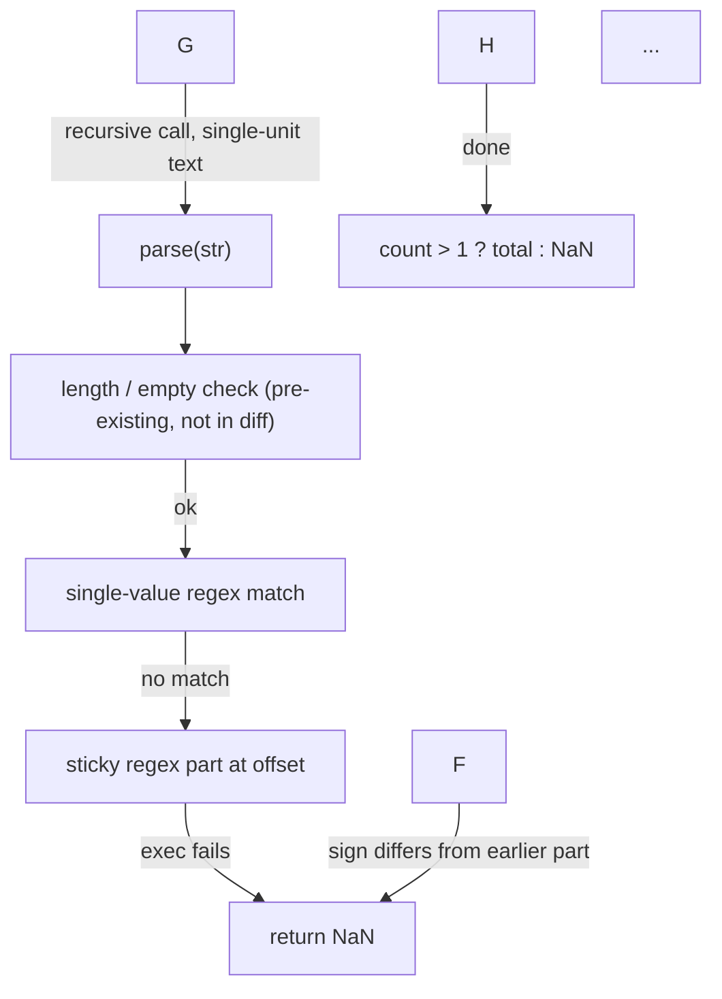
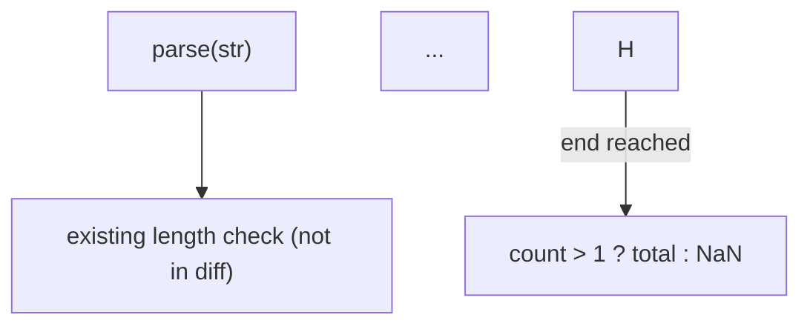

> Commit ids in this log (`08c46fb`, `db559af`) refer to commits from before the history rewrite described in `docs/verification/audits.md`. The log documents the README install and quickstart flow as it was at those commits; later changes are covered by the tests and `scripts/verify.sh`.

# Fresh-user verification (README only)

Date: 2026-11-05. Tester read only `README.md`; no other file in the repo, its source, `docs/` or tests.
Clean machine simulated with a throwaway home. The one allowed substitution: the GitHub URL was replaced
by the local repo (`git+file://~/proj/oss/agent-readback` for uv, a local path for `git clone`).

Environment (`$FRESH/env.sh`, sourced in every shell):

```bash
export HOME=$FRESH XDG_STATE_HOME=$FRESH/.local/state UV_TOOL_DIR=$FRESH/.uv-tools UV_TOOL_BIN_DIR=$FRESH/bin PATH=$FRESH/bin:$PATH
export READBACK_BACKEND=command READBACK_CMD="env HOME=~ claude -p --tools '' --no-session-persistence --setting-sources ''"
```

`READBACK_BACKEND=command` was supplied by the task brief. The README alone does not mention it (see Friction 1).

## 1. Install — PASS

```console
$ uv tool install git+file://~/proj/oss/agent-readback
    Updated file://~/proj/oss/agent-readback (08c46fbe69ef14bcaf4fd770787786ea75c1333f)
Resolved 1 package in 1ms
 + agent-readback==0.1.0 (from git+file://~/proj/oss/agent-readback@08c46fb...)
Installed 1 executable: readback
$ which readback
$FRESH/bin/readback
$ readback --version
agent-readback 0.1.0
```

## 2. Quickstart on a recorded session

### 2a. clone — PASS

```console
$ git clone ~/proj/oss/agent-readback && cd agent-readback
Cloning into 'agent-readback'...
done.
$ ls eval/sessions/
QUESTIONS_README.md  s01  s02  s03  s04  s05  s06
```

### 2b. events (no model call) — PASS

```console
$ readback events -s eval/sessions/s06/transcript.jsonl --diff-file eval/sessions/s06/diff.patch
codex 01a1ab92-0b4a-72f2-a35d-f983bb3d26f7 · 9 events · 3 hunks (file)
   E1 user         Extend `parse` in src/index.ts to accept compound durations such as "1h 30m", "2d3h", "1 …
   E2 assistant    I'll inspect the existing parser and its tests first, then add compound parsing while pre…
   ...
   E8 exec_command $ node --version && if [ -x node_modules/.bin/tsc ]; then node_modules/.bin/tsc --noEmit;…
   E9 assistant    `parse` now sums compound durations such as `1h 30m`, `2d3h`, and `1.5h 10s`. It rejects …
   H1 README.md @@ -154,10 +154,19 @@ As of `v3.0`, you can import `parse` a (+9 -0)
   H2 src/compound.test.ts @@ -0,0 +1,31 @@ (+31 -0)
   H3 src/index.ts @@ -80,7 +80,27 @@ export function parse(str: string): numbe (+21 -1)
```

13 lines, instant.

### 2c. overview — PASS (26.4 s, 29 lines)

```console
$ readback overview -s eval/sessions/s06/transcript.jsonl --diff-file eval/sessions/s06/diff.patch
[command · 9 events · cites 11 · coverage 100% · 26.0s]
**Changed**
- `src/index.ts:parse`: when the single-value regex fails, it now tries the compound grammar instead of returning `NaN` immediately [E6, H3].
- The compound loop uses a sticky regex (`/…/iy`): signed decimal number, optional spaces, unit alternation, then a lookahead ... [H3].
- Mixed signs return `NaN`. The sign is tracked as `component[1].startsWith('-')` against the first component [H3].
...
**Why**
- The user wanted compound inputs summed to ms, single-unit behaviour unchanged, `NaN` for mixed signs or bad parts, and the 100-char limit kept [E1].
...
**Tests**
- `node --test src/compound.test.ts` exited 0. The agent reports all three passed, but the full output is truncated [E8, E9].
- `tsc` was not run ("TypeScript compiler not installed"). `git diff --check` exited 0 [E8].
**Risks**
- The existing suites (`src/parse.test.ts`, ...) were not re-run, so single-unit preservation is only spot-checked [E3, E8].
- Outside the request, the agent grepped `/home/user/.codex/memories/MEMORY.md` (exit 1) and ran `find .. -name AGENTS.md` [E3, E4].
```

### 2d. walkthrough — PASS (38.7 s, 22 lines incl. a leading blank line)

```console
$ readback walkthrough -s eval/sessions/s06/transcript.jsonl --diff-file eval/sessions/s06/diff.patch

[command · 9 events · cites 10 · coverage 100% · 38.7s]
1. **Explore:** Ran `rg` for `agent-readback|compound duration` in `/home/user/.codex/memories/MEMORY.md`, which exited 1 ... [E3].
4. **Plan:** Decided to keep the single-unit regex path and add a full-string compound check ... [E5].
5. **Edit:** In `src/index.ts`, replaced `return NaN` (taken when the single-value regex fails) with a compound loop [E6, H3].
...
13. **Test:** `node --test src/compound.test.ts` exited 0. Pass counts are truncated in the output; the agent claims all three passed [E8, E9].
15. **Not verified** [E8, E9]:
    - Existing suites (...) were never run [E8].
```

### 2e. mechanism — PASS (31.9 s, 39 lines)

````console
$ readback mechanism -s eval/sessions/s06/transcript.jsonl --diff-file eval/sessions/s06/diff.patch
[command · 9 events · cites 6 · coverage 95% · 31.9s]

- **Fallback branch only.** The diff replaces only the old `return NaN` in the `!match?.groups` branch ... [H3, E6].
- **`count > 1` guard.** A lone component that reaches the fallback returns NaN ... [H3].
- **Verification.** ... Inputs without a space before a minus sign, like `'1h-30m'`, are untested [H2].
````

### 2f. ask #1 — PASS (13.8 s, 13 lines)

```console
$ readback ask -s ... "why does the compound loop call parse() recursively instead of converting units itself?"
[command · 9 events · cites 5 · coverage 90% · 13.8s]
**The recursive call reuses the existing single-value parser for unit conversion, so the compound path has no second copy of the multiplier table.** The code comment says so directly: ... [H3]
- The agent's stated plan was to keep "that single-unit path intact" ... [E5].
- **Caveat:** the unit names are still duplicated in the `part` regex alternation, so recognising units is not fully centralised [H3].
- **Not shown:** any reasoning beyond the comment, such as alternatives considered.
```

### 2g. ask #2 — PASS (13.8 s, 12 lines)

```console
$ readback ask -s ... "would '1h-30m' (no space before the minus) be accepted or rejected, and why?"
[command · 9 events · cites 3 · coverage 100% · 13.8s]
**Rejected (`NaN`), but by the mixed-sign check, not because the space is missing.** No-space adjacency is allowed, as in `2d3h` [H2, H3].
- **Part 1:** at `offset` 0, the sticky `part` regex matches `1h` ... lookahead satisfied by `-3` [H3].
- **Part 2:** at `offset` 2, `part` matches `-30m` ... `negative` = `true`, which differs from `sign` = `false`, so the loop executes `return NaN` [H3].
- **Implication:** `-1h-30m` would pass the sign check and sum to `-5_400_000`. That is inferred from the code, not tested [H2, H3].
```

### 2h. ask with no question (print thread) — PASS (instant, exit 0)

```console
$ readback ask -s eval/sessions/s06/transcript.jsonl --diff-file eval/sessions/s06/diff.patch
Q: why does the compound loop call parse() recursively instead of converting units itself?
**The recursive call reuses the existing single-value parser ...
...
Q: would '1h-30m' (no space before the minus) be accepted or rejected, and why?
**Rejected (`NaN`), but by the mixed-sign check ...
```

Thread stored at `$FRESH/.local/state/agent-readback/threads/f2f2781be2fb9ff0.json` (honours `XDG_STATE_HOME`).

## 3. sessions with no sessions — PASS (works), message misleading

```console
$ readback sessions            # in the clone and in $FRESH
no sessions for this directory; showing all (use --all)
$ echo $?
0
$ readback sessions --all
$ echo $?                       # prints nothing at all
0
$ readback overview            # no -s, no sessions anywhere
readback: no Claude Code or Codex sessions found
$ echo $?
2
```

It says "showing all" and then shows nothing; `--all` prints nothing. Neither says that zero sessions exist or
which directories were searched. `overview` gives the clear message.

## 4. web — PASS

```console
$ readback web --no-open --port 8877 -s eval/sessions/s06/transcript.jsonl --diff-file eval/sessions/s06/diff.patch &
readback web view: http://127.0.0.1:8877/  (Ctrl-C to stop)
$ curl -s -w 'HTTP %{http_code} %{content_type} %{size_download}B' http://127.0.0.1:8877/
<!doctype html> ... <title>agent-readback</title> ...
HTTP 200 text/html; charset=utf-8 39555B
$ curl -s http://127.0.0.1:8877/api/session
{"meta": {"agent": "codex", "model": "gpt-6.1-terra", "cwd": "/sandbox/ms", "session_id": "01a1ab92-...", "diff_source": "file", "path": "eval/sessions/s06/transcript.jsonl"}, "total_events": 9, "since": 0, "events": [...], "hunks": [...]}
HTTP 200 application/json        # 9 events, 3 hunks, matches `events`
$ kill %1                        # stopped, port 8877 free afterwards
```

## Extra probe: README-only backend setup — FAIL (documentation gap)

The README says a backend can be "any command via `READBACK_CMD`". Following that literally (only
`READBACK_CMD` set, no `READBACK_BACKEND`), with a `claude` binary on `PATH` that is not signed in:

```console
$ unset READBACK_BACKEND; readback overview --lines 3 -s eval/sessions/s06/transcript.jsonl --diff-file eval/sessions/s06/diff.patch
readback: claude exited 1: {"duration_api_ms":0,"stop_reason":"stop_sequence","session_id":"...","total_cost_usd":0,"usage":{...},"service_tier":"standard",...,"speed":"standard","f
$ echo $?
2
```

Auto-detect picks `claude` over `READBACK_CMD`. The error is raw JSON cut at about 500 characters, before the
field that would say why claude failed (likely "not logged in"). The `--backend` help does list `command`, but
nothing in the README says that `READBACK_BACKEND=command` (or `--backend command`) is needed, or how the
prompt is passed to the command (stdin or argv, where the system prompt goes, what output is expected).

## 5. Output style judgement

| answer | lines | cites | coverage | one screen (~30 rows)? | mechanistic? |
|---|---|---|---|---|---|
| overview | 29 | 11 | 100% | yes, just | yes: regex flags, sign tracking, `count > 1` guard, exact test values |
| walkthrough | 22 | 10 | 100% | yes | yes: ordered explore, plan, edit, test steps with exit codes |
| mechanism | 39 | 6 | 95% | no (Mermaid block plus 20 bullets) | very: control-flow graph plus branch-by-branch rules |
| ask #1 | 13 | 5 | 90% | yes | yes, and flags the unit-list duplication caveat |
| ask #2 | 12 | 3 | 100% | yes | yes: traces offsets and lookahead step by step to `return NaN` |

Every factual bullet carries `[E#]`/`[H#]`. The uncited lines are honest "Not shown" notes, and
the coverage line is printed on every answer. Answers are terse and separate verified from claimed ("the agent
claims all three passed", "inferred from the code, not tested"). Only `mechanism` overruns one screen. Latency
was 14 to 39 s per answer through the `claude -p` command backend.

## Friction

1. **Command backend is underspecified in the README.** It says "any command via `READBACK_CMD`" but not that
   `READBACK_BACKEND=command` is also needed when `claude`/`codex` is on PATH. Auto-detect then picks the CLI and
   fails. It also doesn't say how the command gets the prompt (stdin or argv) or what it must print. The README
   defers to `docs/backends.md`, which a README-only reader (or a PyPI page reader) cannot follow.
2. **Backend failure message is unhelpful.** `claude exited 1: {...raw JSON...` is truncated at about 500 chars,
   before the reason. A newcomer cannot tell it means "not signed in" or "pick another backend".
3. **`readback sessions` with nothing found is misleading.** It prints "no sessions for this directory; showing
   all (use --all)", then shows nothing. `--all` prints nothing, exit 0. It should say "no sessions found under
   <dirs>" and point to `-s <path>` or the recorded eval sessions.
4. **Quickstart order.** The first block (`sessions`, `overview`, ...) assumes an existing session. A newcomer
   runs it first and gets nothing. The "No agent session at hand?" block works but sits second.
5. **No latency or cost hint.** Each answer takes 14 to 39 s of model time and sends up to 40k tokens of
   evidence (default `--budget`, seen in `--help`). The README doesn't mention either.
6. **Minor:** `walkthrough` output starts with a blank line (the other modes don't). `mechanism` (39 lines)
   is longer than the README's "one screen is the default".
7. **Minor:** the README never shows how to view the ask thread (`readback ask` with no question prints it)
   or reset it. The `-s ... --diff-file ...` pair has to be repeated on every command, with no shorter form shown.

Install and the recorded-session quickstart worked from the README alone. The backend set-up used
`READBACK_BACKEND=command` from the task brief, which the README does not explain (Friction 1).

VERDICT: PASS

## Run 2 (after README/CLI fixes)

Clean throwaway home (`$FRESH`, with `HOME`, `XDG_STATE_HOME`, `UV_TOOL_DIR`, `UV_TOOL_BIN_DIR` pointed
into it). Only the README was read. Backend: `READBACK_CMD="env HOME=~ claude -p --tools ''
--no-session-persistence --setting-sources ''"`, with `READBACK_BACKEND` **unset**. Substitution: the
GitHub URL was replaced by the local repo (`git+file://~/proj/oss/agent-readback`, `git clone
~/proj/oss/agent-readback`).

### 1. Install: PASS

```
$ uv tool install git+file://~/proj/oss/agent-readback
 + agent-readback==0.1.0 (from git+file://~/proj/oss/agent-readback@db559af...)
Installed 1 executable: readback
$ readback --version
agent-readback 0.1.0
```

### 2. Quickstart (recorded session): PASS

This run used bash and an unquoted `$S` variable. Audit round 11 found that zsh, the macOS default, does not word-split `$S`, so the README now uses a shell function (`rb() { readback "$@" -s … --diff-file …; }`). That form was re-checked under bash and dash with the `fake` backend; zsh was not installed on the build machine.

```
$ git clone ~/proj/oss/agent-readback && cd agent-readback
$ S="-s eval/sessions/s06/transcript.jsonl --diff-file eval/sessions/s06/diff.patch"
$ readback events $S                      # 0.19 s, 13 lines
codex 01a1ab92-... · 9 events · 3 hunks (file)
   E1 user         Extend `parse` in src/index.ts to accept compound durations such as "1h 30m", ...
   ...
   H3 src/index.ts @@ -80,7 +80,27 @@ export function parse(str: string): numbe (+21 -1)
```

```
$ readback overview $S                    # 25.6 s, ~25 lines
[command · 9 events · cites 10 · coverage 100% · 25.6s]
**Changed**
- `src/index.ts:parse`: when the single-value regex fails, it now tries a sticky compound regex instead of returning `NaN` immediately [E6, H3].
...
**Risks**
- The existing suites (`parse.test.ts`, `index.test.ts`, `parse-strict.test.ts`) were not run, so single-unit regressions are unverified [E3, E8].
```

The header shows `command`, so `READBACK_CMD` alone selected the stdin/stdout backend (no
`READBACK_BACKEND` needed), as the README says.

```
$ readback ask $S "why does a single-part input skip the compound branch?"   # 15.9 s, ~14 lines
[command · 9 events · cites 6 · coverage 90% · 15.9s]
**A single valid part never reaches the compound branch: the branch runs only when the original single-value regex fails, and a lone compound part that does reach it is rejected by `count > 1`.** [H3]
- **Entry gate:** the compound code sits inside `if (!match?.groups)`, which previously just did `return NaN`. ... [H3]
- **Second guard:** ... `return count > 1 ? total : NaN` returns `NaN`. [H3]
...
$ readback ask $S                         # prints the thread, no model call
Q: why does a single-part input skip the compound branch?
**A single valid part never reaches the compound branch: ...** [H3]
...
```

```
$ readback walkthrough $S                 # 41.5 s, 21 lines
[command · 9 events · cites 9 · coverage 100% · 41.5s]
1. **Explore:** Grepped `/home/user/.codex/memories/MEMORY.md` for `agent-readback|compound duration`, which exited 1 ... [E3].
...
13. **Test:** `node --test src/compound.test.ts` exited 0. The per-test output is truncated, so the "all three passed" claim comes from the agent's report [E8, E9].
```

~~~
$ readback mechanism $S                   # 56.6 s, ~55 lines
[command · 9 events · cites 5 · coverage 100% · 56.6s]

- **Entry / fallback:** the compound path runs only when the existing single-value regex yields no `match.groups`. ... [H3].
- **Sticky regex `part`** [H3]: ...
- **Advance** [H3]: ... The `str.endsWith(' ')` guard looks unreachable: the lookahead already rejects trailing spaces. This is an inference from the regex ... [H3].
...
~~~

All exit 0. The clone stayed clean (`git status --short` empty); the only write was
`$FRESH/.local/state/agent-readback/threads/<id>.json`.

### 3. `readback sessions` with no sessions: PASS (message slightly contradictory)

```
$ readback sessions                       # exit 1
No sessions for this directory; showing all (use --all)
no sessions found (looked in $FRESH/.claude/projects and $FRESH/.codex/sessions); pass a transcript path with -s, or set READBACK_CLAUDE_DIR / READBACK_CODEX_DIR
```

### 4. Web view: PASS

```
$ readback web $S --no-open --port 8878 &
readback web view: http://127.0.0.1:8878/  (Ctrl-C to stop)
$ curl -s http://127.0.0.1:8878/            -> HTTP 200, 39,555 B, <!doctype html> ... <title>agent-readback</title>
$ curl -s http://127.0.0.1:8878/api/session -> HTTP 200 application/json
  keys: meta, total_events, since, events, hunks   (9 events, 3 hunks; meta.agent=codex, diff_source=file)
$ kill %1
```

### 5. Judgement

- **Concise / fits a screen:** `overview` (~25 lines), `ask` (~14) and `walkthrough` (21) fit one
  terminal screen. `mechanism` does not: ~55 lines (a 17-line Mermaid block plus ~38 nested bullets).
- **Mechanistic:** yes. Answers name the actual guards (`if (!match?.groups)`, `count > 1`, sticky `/iy`
  regex, lookahead, recursive `parse(component[0])`) and the concrete test inputs, and they separate
  what is verified from what is inferred or not run.
- **Citations:** every factual line carries `[E#]`/`[H#]`; coverage 90-100%. `ask` sat exactly at the
  90% repair threshold.

### Friction

1. `mechanism` runs past one screen (~55 lines) and took 56.6 s, which is above the README's "about
   10-45 s" estimate. `walkthrough` (41.5 s) was close to the top of it.
2. `readback sessions` with zero sessions prints "showing all (use --all)" and then "no sessions found".
   The first line suggests a fallback that has nothing to show. The second line is good (paths searched,
   `-s`, `READBACK_*_DIR`).
3. The README Quickstart does not mention `--port` / `--no-open` for `readback web` (they worked; they
   came from the task brief, not the README). Minor.
4. Not a readback issue: the `claude` child process inherited `XDG_STATE_HOME` and created
   `$FRESH/.local/state/claude`.
5. Resolved since run 1: `READBACK_CMD` alone is enough (the `command` backend was auto-detected, and
   `READBACK_BACKEND` was not set).

VERDICT (run 2): PASS
